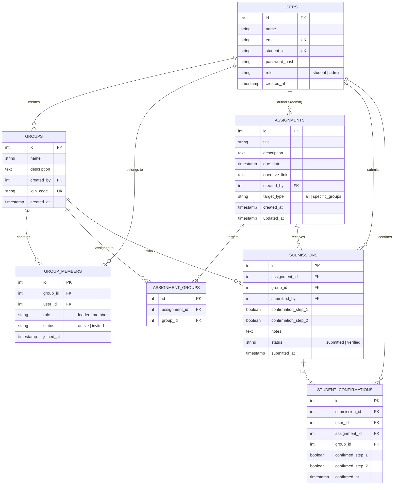

# 🎓 JoinEazy — Student, Group & Assignment Management System

A robust, role-based full-stack web application designed for **Joineazy** to empower students to form collaborative groups, manage teammates, and confirm assignment submissions via two-step verification — while allowing professors (admins) to manage coursework, distribute assignments, track progress, and view analytics.

---

## 📌 Table of Contents
1. [Overview & Features](#-overview--features)
2. [Technology Stack](#-technology-stack)
3. [System Architecture](#-system-architecture)
4. [Database Schema & ER Diagram](#-database-schema--er-diagram)
5. [API Endpoints Documentation](#-api-endpoints-documentation)
6. [Setup & Running Instructions](#-setup--running-instructions)
   - [Option A: Docker Deployment (Recommended)](#option-a-docker-deployment-recommended)
   - [Option B: Local Development (Zero-Setup Mode)](#option-b-local-development-zero-setup-mode)
7. [Pre-configured Demo Accounts](#-pre-configured-demo-accounts)
8. [Key Design & Architectural Decisions](#-key-design--architectural-decisions)

---

## 🚀 Overview & Features

### 👨‍🎓 Student Role
* **Authentication**: Register with Name, Email, Student ID, and secure JWT session management.
* **Group Management**:
  * Create new study/project groups (automatically designated as Group Leader).
  * Unique alphanumeric Join Codes (e.g., `GRP-ALPHA`) for effortless team joining.
  * Invite and add peers directly by **Student Email** or **Student ID**.
  * Remove members or voluntarily leave groups.
* **Assignment Access**:
  * View all assignments posted by professors (both general coursework and group-targeted).
  * One-click direct access to external **OneDrive submission links**.
* **Two-Step Verification Submission**:
  * **Step 1**: Checkbox affirmation: *"Yes, I have submitted"* (verifying upload to external OneDrive folder).
  * **Step 2**: Final confirmation and submission logging on behalf of the group.
  * Peer participation confirmation: Teammates can log their individual confirmation for group work.
* **Visual Progress Tracking**:
  * Visual progress bars representing coursework completion percentage.
  * Milestone badges earned based on achievements (*"Team Player"*, *"Group Leader"*, *"All Caught Up"*, *"On A Roll"*, *"First Milestone"*).

### 👨‍🏫 Admin (Professor) Role
* **Assignment Management**:
  * Create, edit, and delete assignments with title, instructions, due date/time, and OneDrive link.
  * Flexible targeting: Assign coursework to **All Student Groups** or restrict to **Specific Groups**.
* **Group & Student Submission Tracking**:
  * Unified tracking dashboard displaying group submission status and submission timestamps.
  * **Student-wise Confirmation Breakdown**: Drill-down view into each group member's 2-step verification status, student ID, and confirmation timestamp.
  * Professor verification action to inspect notes and approve submissions.
* **Analytics & Performance Insights**:
  * Summary metrics: Total Assignments, Student Groups, Enrolled Students, Confirmed Submissions.
  * Overall cohort completion rate with visual status meters.
  * Group performance table: Completed vs pending counts and completion rates per group.
  * Assignment completion breakdown with overdue indicators.
  * Real-time activity feed of incoming submissions.

---

## 🛠 Technology Stack

| Layer | Technologies |
| :--- | :--- |
| **Frontend** | React 18, Vite, Tailwind CSS, Lucide React, Axios, React Router v6 |
| **Backend** | Node.js, Express.js, RESTful Architecture, CORS, Dotenv |
| **Database** | PostgreSQL, `pg` driver (with zero-setup fallback via `pg-mem`) |
| **Authentication** | JWT (JSON Web Tokens), `bcryptjs` password hashing |
| **Containerization** | Docker, Docker Compose, Multi-stage Docker builds, Nginx |

---

## 🏛 System Architecture

The following diagram illustrates the request flow and component interaction:

```mermaid
flowchart TD
    subgraph Client ["Client Layer (Browser)"]
        UI["React 18 + Tailwind CSS"]
        AuthContext["Auth Context & JWT Storage"]
        TwoStepModal["Two-Step Verification Modal"]
        UI --> AuthContext
        UI --> TwoStepModal
    end

    subgraph Gateway ["Web & Proxy Server"]
        Nginx["Nginx Reverse Proxy (:80 / :3000)"]
    end

    subgraph Backend ["Backend API Layer (:5000)"]
        Express["Express.js Server"]
        JWTAuth["JWT & Role Guard Middleware"]
        Controllers["Controllers (Auth, Groups, Assignments, Submissions, Analytics)"]
        
        Express --> JWTAuth
        JWTAuth --> Controllers
    end

    subgraph Database ["Data Layer"]
        Postgres[("PostgreSQL Database / pg-mem Pool")]
    end

    Client -->|HTTP / REST API| Nginx
    Nginx -->|Proxy /api/*| Express
    Controllers -->|SQL Queries ($1, $2)| Postgres
```

---

## 🗄 Database Schema & ER Diagram



---

## 📡 API Endpoints Documentation

All protected endpoints require an `Authorization: Bearer <JWT>` header.

### 1. Authentication (`/api/auth`)
| Method | Endpoint | Access | Description |
| :--- | :--- | :--- | :--- |
| `POST` | `/api/auth/register` | Public | Register a student or admin |
| `POST` | `/api/auth/login` | Public | Authenticate user & receive JWT |
| `GET` | `/api/auth/me` | Authenticated | Fetch current user profile & active groups |
| `GET` | `/api/auth/students/search` | Authenticated | Search students by name, email, or student ID |

### 2. Group Management (`/api/groups`)
| Method | Endpoint | Access | Description |
| :--- | :--- | :--- | :--- |
| `POST` | `/api/groups` | Student | Create a new group (creator becomes Leader) |
| `GET` | `/api/groups/my` | Student | List user's groups with members |
| `GET` | `/api/groups/all` | Admin | List all student groups with stats |
| `POST` | `/api/groups/join` | Student | Join group using 8-char join code |
| `GET` | `/api/groups/:id` | Authenticated | Get detailed group profile & coursework |
| `POST` | `/api/groups/:id/members` | Group Member | Add student by email or Student ID |
| `DELETE`| `/api/groups/:id/members/:userId` | Leader/Self | Remove a member or leave group |

### 3. Assignments (`/api/assignments`)
| Method | Endpoint | Access | Description |
| :--- | :--- | :--- | :--- |
| `GET` | `/api/assignments` | Authenticated | List assignments (role-aware filtering) |
| `GET` | `/api/assignments/:id` | Authenticated | Fetch specific assignment details |
| `POST` | `/api/assignments` | Admin | Create assignment with OneDrive link & target |
| `PUT` | `/api/assignments/:id` | Admin | Update assignment information |
| `DELETE`| `/api/assignments/:id` | Admin | Delete assignment |

### 4. Submissions & Confirmations (`/api/submissions`)
| Method | Endpoint | Access | Description |
| :--- | :--- | :--- | :--- |
| `POST` | `/api/submissions/two-step-confirm` | Student | Submit assignment with two-step verification |
| `POST` | `/api/submissions/peer-confirm` | Student | Teammate verifies participation |
| `GET` | `/api/submissions/assignment/:id` | Authenticated | Get group-wise & student-wise confirmations |
| `PUT` | `/api/submissions/:id/verify` | Admin | Mark submission as verified |

### 5. Analytics (`/api/analytics`)
| Method | Endpoint | Access | Description |
| :--- | :--- | :--- | :--- |
| `GET` | `/api/analytics/admin` | Admin | Overall completion rate, group performance, activity |
| `GET` | `/api/analytics/student-progress` | Student | Personal/group progress bar %, badges, status |

---

## ⚡ Setup & Running Instructions

### Option A: Docker Deployment (Recommended)
Prerequisites: **Docker** and **Docker Compose** installed.

1. Clone repository:
   ```bash
   git clone <repo-url>
   cd JoinEazy
   ```

2. Run with Docker Compose:
   ```bash
   docker-compose up --build
   ```

3. Open in your browser:
   - **Frontend Application**: [http://localhost:3000](http://localhost:3000) or [http://localhost](http://localhost)
   - **Backend API**: [http://localhost:5000/health](http://localhost:5000/health)

---

### Option B: Local Development (Zero-Setup Mode)
No separate PostgreSQL installation required! If PostgreSQL is not running, the application automatically initializes an embedded in-memory PostgreSQL engine (`pg-mem`) and auto-seeds sample data.

1. **Install backend & frontend dependencies:**
   ```bash
   # Terminal 1: Backend
   cd backend
   npm install
   npm start
   # Server runs on http://localhost:5000

   # Terminal 2: Frontend
   cd frontend
   npm install
   npm run dev
   # Frontend runs on http://localhost:3000
   ```

2. Navigate to [http://localhost:3000](http://localhost:3000) in your browser.

---

## 🔑 Pre-configured Demo Accounts

For immediate evaluation, the login page features **1-Click Demo Buttons** to autofill and log into these pre-seeded accounts:

| Role | Name | Email | Password | Identifier |
| :--- | :--- | :--- | :--- | :--- |
| **Professor (Admin)** | Prof. Dr. Sarah Jenkins | `admin@joineazy.com` | `admin123` | N/A |
| **Student (Leader)** | Alex Rivera | `alex@joineazy.com` | `student123` | `STU2024-001` |
| **Student (Member)** | Emma Watson | `emma@joineazy.com` | `student123` | `STU2024-002` |
| **Student (Leader)** | Liam Chen | `liam@joineazy.com` | `student123` | `STU2024-003` |
| **Student (Member)** | Sophia Patel | `sophia@joineazy.com` | `student123` | `STU2024-004` |

---

## 💡 Key Design & Architectural Decisions

1. **Two-Step Verification Protocol**:
   Students upload their project files to an external OneDrive folder. To prevent false confirmations, the system enforces:
   - Step 1: Explicit acknowledgment checkbox confirming file upload to OneDrive.
   - Step 2: Final confirmation button that logs the submission and timestamps student confirmation.

2. **Group-Level vs. Student-Level Confirmation Separation**:
   In collaborative academic tasks, one student often uploads the group archive, but professors need visibility into which individual team members confirmed participation. The database tracks both the group-level submission (`submissions` table) and granular individual student confirmations (`student_confirmations` table).

3. **Dual-Mode Database Architecture (Production PostgreSQL + Zero-Setup Mode)**:
   The backend is fully PostgreSQL-native using standard SQL parameterized queries (`$1`, `$2`), foreign keys, and cascading deletes. To make technical review effortless without requiring local database provisioning, the backend gracefully falls back to an in-memory PostgreSQL engine if `DATABASE_URL` is unavailable.

4. **Role-Based Authorization Middleware**:
   JWT tokens encode user roles (`student` vs. `admin`). Protected Express endpoints enforce role verification with HTTP 403 Forbidden responses, and React routes use a declarative `<ProtectedRoute allowedRoles={['admin']} />` wrapper.

5. **Responsive and Accessible UI**:
   Tailwind CSS styling delivers a clean modern dashboard with color-coded progress bars, badges, responsive tables, and mobile-friendly collapsible views.
